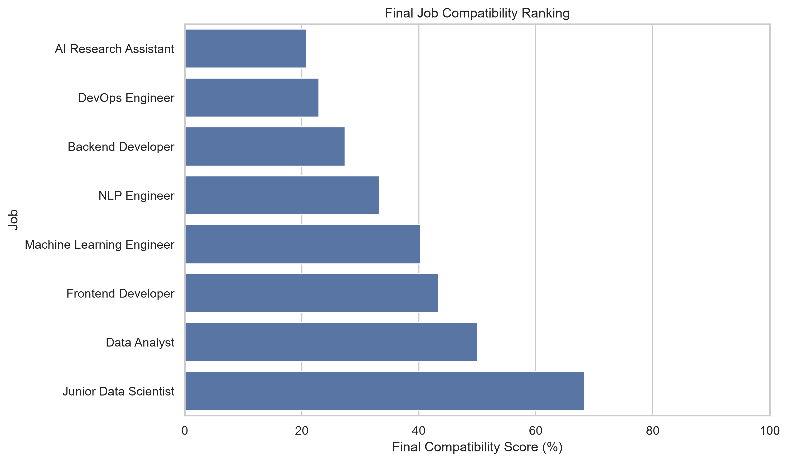
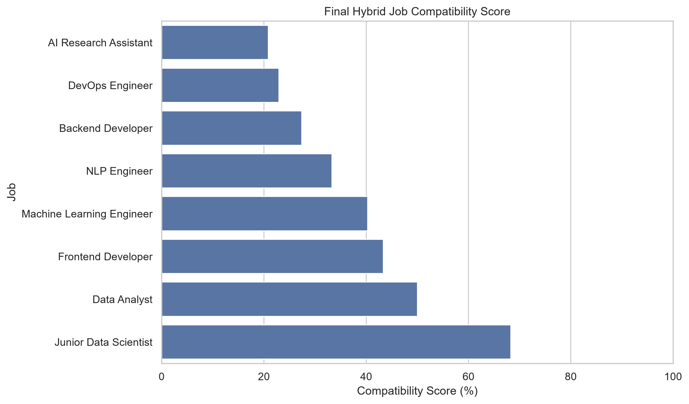
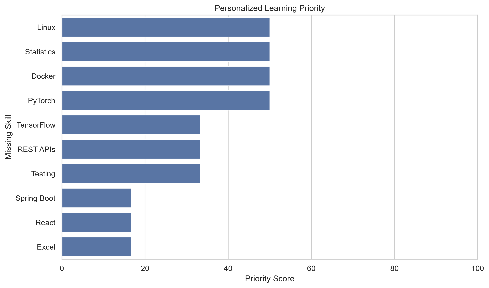

# 🤖 AI Job Skill Gap Analyzer

An NLP-powered career analysis tool that compares a user's technical skills with job descriptions, identifies skill gaps, ranks suitable roles, and generates personalized learning priorities.

The project combines **rule-based skill extraction, skill-gap analysis, TF-IDF, cosine similarity, and hybrid scoring** to create an interpretable job-matching and career-planning system.

---

## 🎯 Project Overview

Choosing which technical skills to learn can be difficult when job descriptions contain many different technologies and requirements.

This project analyzes a user's current technical skills against multiple job descriptions and answers three key questions:

1. **Which jobs are the best match for the user's current skills?**
2. **Which skills are missing for those jobs?**
3. **Which missing skills should be prioritized for learning?**

The system goes beyond simple keyword matching by combining explicit skill coverage with NLP-based text similarity.

---

## 🚀 Key Features

* 🔍 Technical skill extraction from job descriptions
* 📊 Skill-gap analysis
* 💼 Job compatibility ranking
* 🧠 TF-IDF text representation
* 📐 Cosine similarity
* ⚖️ Hybrid job compatibility scoring
* 📚 Personalized learning priorities
* 🎯 Target-role skill analysis
* 📈 Data visualizations
* 💾 Exported CSV results
* 🧩 Reusable Python source module
* 🛡️ Boundary-aware skill extraction to reduce false positives

---

## 🔄 Project Workflow

```text
User Skills
     │
     ▼
Skill Extraction
     │
     ▼
Skill Gap Analysis
     │
     ▼
Job Compatibility
     │
     ├───────────────► Skill Demand Analysis
     │                         │
     │                         ▼
     │                  Learning Priority
     │
     ▼
TF-IDF Vectorization
     │
     ▼
Cosine Similarity
     │
     ▼
Hybrid Compatibility Score
     │
     ▼
Recommended Job
     │
     ▼
Personalized Learning Roadmap
```

---

## 📊 Project Visualizations

### Final Job Compatibility Ranking



### Hybrid Job Compatibility



### Personalized Learning Roadmap



---

## 🧠 Matching Methodology

The project uses two complementary approaches to evaluate job compatibility.

### 1. Explicit Skill Matching

The system compares the user's skills with the required skills for each job.

```text
Skill Match =
Matched Skills / Required Skills × 100
```

This provides an interpretable measure of how many required skills the user already possesses.

### 2. NLP-Based Similarity

TF-IDF converts the user's technical profile and job descriptions into numerical vectors.

Cosine similarity is then used to measure the textual similarity between the user's profile and each job description.

```text
Cosine Similarity

0 → Low Similarity
1 → High Similarity
```

The implementation also uses unigrams and bigrams to capture technical phrases such as:

* Machine Learning
* Spring Boot
* REST APIs
* Deep Learning

### 3. Hybrid Compatibility Score

The two signals are combined into a single compatibility score:

```text
Final Score =
    70% × Skill Match
  + 30% × NLP Similarity
```

Explicit skill coverage receives greater weight because it provides a more direct and interpretable measure of whether the user currently satisfies a job's requirements.

---

## 📊 Example Results

Using the project's sample user profile and job dataset, the system produced the following results:

| Job                       | Skill Match | NLP Similarity | Final Score |
| ------------------------- | ----------: | -------------: | ----------: |
| **Junior Data Scientist** |  **85.71%** |     **27.61%** |  **68.28%** |
| Data Analyst              |      66.67% |         11.26% |      50.04% |
| Frontend Developer        |      57.14% |         11.21% |      43.36% |
| Machine Learning Engineer |      50.00% |         17.67% |      40.30% |
| NLP Engineer              |      42.86% |         10.98% |      33.29% |

### 🎯 Recommended Role

**Junior Data Scientist**

* **Skill Match:** 85.71%
* **NLP Similarity:** 27.61%
* **Final Compatibility:** 68.28%
* **Primary Target Skill Gap:** Statistics

---

## 📚 Learning Priority Analysis

The system identifies missing skills and ranks them according to their demand across the analyzed job descriptions.

### High-Priority Skills

* Linux
* Statistics
* Docker
* PyTorch

### Medium-Priority Skills

* TensorFlow
* REST APIs
* Testing

This allows the system to move beyond simply identifying missing skills and provide a prioritized learning direction.

The project also distinguishes between **global skill demand** and **target-job skill gaps**. For example, a skill may be highly demanded across the dataset while not being immediately necessary for the user's recommended role.

---

## 🛡️ Robust Skill Extraction

The initial prototype used simple substring matching. The final implementation uses boundary-aware regular expressions to reduce false positives.

For example:

```text
JavaScript → JavaScript ✓
JavaScript → Java ✗
```

This is particularly important when working with technical skills whose names overlap.

The reusable implementation is located in:

```text
src/skill_analyzer.py
```

---

## 🛠️ Technologies

### Programming & Data

* Python
* Pandas
* NumPy

### Machine Learning & NLP

* Scikit-learn
* TF-IDF
* Cosine Similarity
* Regular Expressions

### Visualization

* Matplotlib
* Seaborn

### Development

* Jupyter Notebook
* VS Code
* Git
* GitHub

---

## 📁 Project Structure

```text
job-skill-gap-analyzer/
│
├── data/
│   ├── job_descriptions.csv
│   ├── job_compatibility_results.csv
│   └── learning_roadmap.csv
│
├── images/
│   ├── top_15_skill_demand.png
│   ├── learning_priority.png
│   ├── job_recommendation_ranking.png
│   ├── tfidf_job_similarity.png
│   ├── hybrid_job_compatibility.png
│   ├── personalized_learning_roadmap.png
│   └── final_job_ranking.png
│
├── notebooks/
│   └── job_skill_gap_analysis.ipynb
│
├── src/
│   └── skill_analyzer.py
│
├── .gitignore
├── README.md
└── requirements.txt
```

---

## ▶️ How to Run

### 1. Clone the repository

```bash
git clone <repository-url>
cd job-skill-gap-analyzer
```

### 2. Install dependencies

```bash
pip install -r requirements.txt
```

### 3. Open the notebook

Open:

```text
notebooks/job_skill_gap_analysis.ipynb
```

using VS Code or Jupyter Notebook.

### 4. Run the notebook

Run the cells from top to bottom to reproduce the complete analysis.

The notebook generates:

* Job compatibility results
* Learning priorities
* NLP similarity results
* Visualizations
* CSV exports

---

## 📂 Generated Results

The project automatically exports analysis results to the `data/` directory.

### `job_descriptions.csv`

Contains the sample job dataset used for the analysis.

### `job_compatibility_results.csv`

Contains:

* Job title
* Category
* Skill match
* NLP similarity
* Final compatibility score
* Matched skills
* Missing skills

### `learning_roadmap.csv`

Contains:

* Missing skill
* Job demand
* Priority score
* Priority level

---

## ⚠️ Dataset Note

The current version uses a small representative job dataset created specifically to demonstrate the complete analysis pipeline.

The dataset is intentionally compact so that the methodology is easy to understand, reproduce, and inspect.

The current scores should therefore be interpreted as **demonstration results rather than real-world labor-market statistics**.

For a production-oriented version, the system could be extended with a larger and more diverse collection of real-world job descriptions.

---

## 🔮 Future Improvements

Potential future improvements include:

* [ ] Add a larger real-world job-description dataset
* [ ] Allow users to enter their own skills
* [ ] Allow users to paste individual job descriptions
* [ ] Add resume/PDF skill extraction
* [ ] Add semantic embeddings
* [ ] Compare TF-IDF with transformer-based embeddings
* [ ] Add job-category-specific learning priorities
* [ ] Recommend learning resources for missing skills
* [ ] Build an interactive Streamlit web application
* [ ] Add user learning-progress tracking
* [ ] Deploy the application online

---

## 💡 What This Project Demonstrates

This project demonstrates practical experience with:

* Python programming
* Data preprocessing
* Natural Language Processing
* TF-IDF vectorization
* Cosine similarity
* Feature extraction
* Rule-based information extraction
* Recommendation logic
* Data visualization
* Modular Python development
* CSV data processing
* Reproducible analysis
* Git/GitHub project organization

---

## 📌 Project Status

**Completed — Portfolio Project**

The current version implements the complete job skill-gap analysis pipeline, from user skill analysis and job matching to NLP similarity, job recommendation, and personalized learning priorities.

---

## 👨‍💻 Author

**Rajesh**

GitHub: [Rajesh-code11](https://github.com/Rajesh-code11)
